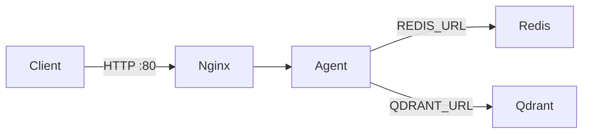

# Day 14 Lab — Mission Answers

Ngày thực hành: 25/11/2026 (GMT+7). Các phép đo dùng Docker Desktop Linux và Python 3.11 trong container. Toàn bộ LLM là mock, không dùng API trả phí. Đã deploy agent và Redis lên Render miễn phí, kiểm tra đủ bốn HTTP status bắt buộc.

## Part 1: Localhost vs Production

### Exercise 1.1 — Anti-patterns

Trong `01-localhost-vs-production/develop/app.py`:

1. Dòng 17: API key nằm trong source; ai đọc repo hoặc lịch sử Git đều thấy được.
2. Dòng 18: connection string chứa tài khoản/mật khẩu; cấu hình database bị gắn với máy local.
3. Dòng 21 và 53: debug/reload bật cố định, không phù hợp vận hành production.
4. Dòng 33–38: dùng `print` và in credential ra log; khó truy vấn log và làm lộ secret.
5. Không có `/health` và `/ready`: nền tảng không phân biệt process sống với khả năng phục vụ.
6. Dòng 51: bind `localhost`, bên ngoài container không truy cập được.
7. Dòng 52: port 8000 cố định, không dùng `PORT` do nền tảng cấp.
8. Không có lifecycle cleanup cho connections và tài nguyên khi shutdown.

### Exercise 1.2 — Chạy develop

Đã gọi `POST /ask?question=Hello`, nhận HTTP 200 và JSON `answer`. Bản develop nhận query parameter; gửi JSON theo hướng dẫn cũ có thể trả 422. Output thực tế nằm trong [`reports/local_exercises.json`](reports/local_exercises.json), khóa `part1_develop`. Script tái lập: `scripts/run_local_exercises.py`.

### Exercise 1.3 — So sánh

| Feature | Develop | Production mẫu | Vì sao quan trọng? |
|---|---|---|---|
| Config | Giá trị cố định trong source | Đọc settings từ env | Cùng code chạy được ở nhiều môi trường, tách secret khỏi Git |
| Health/readiness | Không có | `/health`, `/ready` | Restart process hỏng; ngừng route tới instance chưa sẵn sàng |
| Logging | `print`, có secret | Logger, dữ liệu theo field | Dễ tìm kiếm sự cố, hạn chế lộ credential |
| Shutdown | Không cleanup | `lifespan` có cleanup | Hoàn tất request đang xử lý trước khi đóng tài nguyên |
| Binding/port | localhost:8000 | Host/port theo config | Chạy được trong container và trên cloud |

Đã gọi bản production mẫu: `/ask` và `/health` đều 200. Đây là ví dụ học concept; log mẫu ghép chuỗi JSON có thể bị sai khi message chứa dấu nháy. Part 6 dùng formatter `json.dumps` để luôn tạo JSON hợp lệ. Các handler signal của ví dụ cũng cần xem lại khi chạy bằng CLI; Part 6 để Uvicorn quản lý signal.

## Part 2: Docker

### Exercise 2.1 — Dockerfile

1. Base image là `python:3.11`.
2. Working directory là `/app`.
3. Copy `requirements.txt` trước source để Docker tái dùng layer cài dependencies khi chỉ sửa code.
4. `ENTRYPOINT` định nghĩa chương trình chính; `CMD` cung cấp lệnh hoặc tham số mặc định. Đối số sau image thường thay `CMD`, còn `--entrypoint` thay `ENTRYPOINT`. Exec form giúp process nhận signal trực tiếp.

### Exercise 2.2–2.3 — Build, chạy và so sánh

Build từ gốc repo bằng hai Dockerfile trong `02-docker/`. Kết quả đo bằng `docker image inspect`:

| Image | Bytes | MiB |
|---|---:|---:|
| `my-agent:develop` | 1667792692 | 1590.53 |
| `my-agent:advanced` | 239815385 | 228.71 |

Giảm khoảng **85,62%** theo `(develop - advanced) / develop × 100`. Số byte là số đo gốc, không lấy kích thước minh họa trong README. Bằng chứng: [`reports/docker_examples.json`](reports/docker_examples.json) và [`reports/docker_image_sizes.txt`](reports/docker_image_sizes.txt).

Stage builder cài compiler và dependencies; stage runtime chỉ giữ Python slim, packages và source cần chạy. Build tools không đi vào image cuối. Bản develop đã được gọi qua port host 18000, để tránh trùng các phần khác.

### Exercise 2.4 — Compose stack



Compose khai báo agent, Redis, Qdrant và Nginx trên mạng nội bộ. Agent không publish port trực tiếp. Redis lưu state/cache, Qdrant là vector database được khai báo trong stack; demo mock chưa thực hiện RAG thật. File `.env.local` được tạo local và bị Git ignore. Dùng project `k5-day14-docker` để tránh nhầm image với các thư mục cùng tên `production`.

Kết quả `/health` và `POST /ask` qua Nginx được lưu trong `reports/docker_examples.json`.

## Part 3: Cloud Deployment

### Exercise 3.1/3.2 — Trạng thái

Railway bị hạn chế workspace nên học viên chọn Render miễn phí. Agent và Redis đã deploy thành công. Public URL: [https://k5-day14-agent-j5ql.onrender.com](https://k5-day14-agent-j5ql.onrender.com); `/health` 200, `/ready` 200, `/ask` thiếu key 401 và có key 200. Bằng chứng và ảnh dashboard trong [`DEPLOYMENT.md`](DEPLOYMENT.md).

### So sánh Railway và Render

| Mục | Railway (`railway.toml`) | Render (`render.yaml`) |
|---|---|---|
| Định dạng | TOML | YAML Blueprint |
| Build | `[build] builder="DOCKERFILE"` | Web service với `runtime: docker` |
| Health | `[deploy] healthcheckPath="/health"` | `healthCheckPath: /health` |
| Secret | Đặt trong service variables/dashboard | `envVars`, dùng `generateValue` hoặc `sync: false` |
| Redis | Tạo Redis riêng, tham chiếu URL vào agent | Khai báo/tạo Redis riêng và truyền URL |

Cả hai cần deploy agent Part 6 và Redis, bind `0.0.0.0`, nhận port từ môi trường. Bài có cấu hình Railway và Blueprint Render đầy đủ; Render dùng gói free cho cả web service và Key Value.

### Exercise 3.3 — Pipeline Cloud Run

`cloudbuild.yaml` chạy test, build image với tag commit SHA và `latest`, push registry, rồi gọi `gcloud run deploy` ở `asia-southeast1`.
Các bước build/push/deploy được nối bằng `waitFor`; secrets được tham chiếu từ Secret Manager.
`service.yaml` mô tả container, CPU/memory, concurrency 80, timeout 60 giây, scale 1–10 instance và probes `/health`, `/ready`.
Lưu ý bước test mẫu có `echo` sau `pytest`; cần `set -e` hoặc nối bằng `&&` để tránh che exit code lỗi của test. Bài này chỉ đọc pipeline, không chạy GCP.

## Part 4: API Security

### Exercise 4.1 — API key

Đã chạy bản develop với key ngẫu nhiên truyền qua env: thiếu key trả 401, đúng key trả 200. Không lưu key vào report. Xem `part4_missing`, `part4_authorized` trong `reports/local_exercises.json`.

### Exercise 4.2 — JWT

Gọi `POST /auth/token` bằng tài khoản demo `student`, nhận 200. Dùng token trong `Authorization: Bearer ...`; token đã được thay bằng `[REDACTED]` trong bằng chứng. JWT có chữ ký, claims và hạn dùng; API key là secret định danh client, cần thu hồi/xoay key riêng.

### Exercise 4.3 — Rate limit

Với cùng token student, 15 lần gọi `/ask` cho kết quả: **10 lần 200, tiếp theo 5 lần 429**. Response 429 kèm header rate-limit/retry của bản mẫu. Chi tiết headers/body từng response trong `part4_burst` của `reports/local_exercises.json`.

Rate limit hạn chế tốc độ gọi; không thay thế giới hạn chi phí, vì mỗi request có thể dùng số token hoặc model khác nhau.

Các response HTTP đã thu bằng client, trình bày status/headers/body từ artifact (không chứa credential):

```text
Status: 401
date: Wed, 25 Nov 2026 08:12:46 GMT
server: uvicorn
content-length: 67
content-type: application/json

{"detail": "Missing API key. Include header: X-API-Key: <your-key>"}
```

```text
Status: 200
date: Wed, 25 Nov 2026 08:12:46 GMT
server: uvicorn
content-length: 114
content-type: application/json

{"question": "Hello", "answer": "Agent đang hoạt động tốt! (mock response) Hỏi thêm câu hỏi đi nhé."}
```

```text
Status: 429
date: Wed, 25 Nov 2026 08:12:48 GMT
server: uvicorn
x-ratelimit-limit: 10
x-ratelimit-remaining: 0
x-ratelimit-reset: 1795594428
retry-after: 59
content-length: 98
content-type: application/json
x-content-type-options: nosniff
x-frame-options: DENY
x-xss-protection: 1; mode=block
referrer-policy: strict-origin-when-cross-origin

{"detail": {"error": "Rate limit exceeded", "limit": 10, "window_seconds": 60, "retry_after_seconds": 59}}
```


### Exercise 4.4 — Cost guard

Kiểm tra ngân sách trước khi gọi LLM, cộng chi phí sau khi nhận usage. Công thức: `input_tokens / 1000 × input_price + output_tokens / 1000 × output_price`. Bản mẫu Part 4 giữ usage trong RAM; Part 6 chuyển sang Redis, theo ngày/tháng UTC, trả 402 khi hết ngân sách. Hạn mức mặc định Part 6: 1 USD/ngày và 10 USD/tháng.

Mock Part 6 không cung cấp tokenizer nên usage được ước tính từ số từ; đây không phải hóa đơn provider. Kiểm tra trước và ghi nhận sau có thể vượt budget bằng chi phí của request đang xử lý, nhất là khi chạy đồng thời. Nếu dùng LLM thật cần cơ chế reserve/reconcile ngân sách và usage chính xác từ provider.

## Part 5: Scaling & Reliability

### Exercise 5.1 — Health và readiness

Đã gọi `/health` và `/ready` của ví dụ develop, đều 200. Liveness trả lời process còn sống không; readiness trả lời instance đã đủ dependencies để nhận traffic chưa. Part 6 còn được kiểm tra Redis mất kết nối: `/health` vẫn 200, `/ready` trả 503.

### Exercise 5.2 — Graceful shutdown

SIGTERM yêu cầu server ngừng nhận kết nối mới, đợi request in-flight rồi chạy lifecycle cleanup. SIGKILL không cho cleanup. Part 6 dùng lifespan và giữ handler Uvicorn; Docker khởi chạy bằng `exec` để Uvicorn là PID 1. Script chấm đã xác nhận request đang chạy trả 200 và process thoát 0; xem output Part 6 bên dưới.

### Exercise 5.3 — Stateless

RAM thuộc từng process; session lưu ở instance A sẽ không tồn tại ở B và mất khi A restart. Lưu session ở Redis giúp mọi instance đọc cùng history. Rate limit và cost guard cũng cần state chung để tránh nhân hạn mức theo số worker.

### Exercise 5.4–5.5 — Ba instance và history

Chạy stack project `k5-day14-scaling`, scale agent=3. Dùng override `scripts/scaling-ports.yml` chuyển cổng host sang 8081 để không trùng observability 8080. Script test chỉ thêm khả năng đọc `AGENT_URL`, mặc định vẫn giữ 8080.

Kết quả thực tế: 5 câu hỏi được xử lý bởi `instance-44be08`, `instance-3e3c42`, `instance-1d4f59`; history có **10 messages**, gồm 5 user và 5 assistant. Bằng chứng: [`reports/stateless_scaling.txt`](reports/stateless_scaling.txt). Script không chủ động tắt instance nào trong lần kiểm tra này.

## Part 6: Production-ready agent

Code đã hoàn thiện trong `06-lab-complete/app/`: env config, auth dùng constant-time comparison, Redis client lazy connection, sliding window Lua atomic, cost counters Redis, JSON logging và lifespan cleanup. Docker image multi-stage slim, non-root; Compose có agent và Redis với AOF volume.

Script chấm được chạy nguyên bản trên Linux/Python 3.11, Docker socket và host networking; không sửa `check_production_ready.py`. Output đầy đủ: [`reports/production_ready.txt`](reports/production_ready.txt).

```text
📋 Checklist Deliverable
     ✅ Dockerfile (multi-stage, < 500 MB)
     ✅ docker-compose.yml (agent + redis)
     ✅ .dockerignore
     ✅ Health check endpoint (GET /health)
     ✅ Readiness endpoint (GET /ready)
     ✅ API Key authentication
     ✅ Rate limiting
     ✅ Cost guard
     ✅ Config từ environment variables
     ✅ Structured logging
     ✅ Graceful shutdown
     ✅ Public URL ready (Railway / Render config)
----------------------------------------------------------------
  Result: 12/12 tiêu chí đạt · 44/44 checks passed
  🎉 PASS 12/12 — PRODUCTION READY! Deploy nào!
================================================================
```

## AI log

| Yêu cầu đã dùng AI | Hỗ trợ nhận được | Chỉnh sửa và kiểm tra |
|---|---|---|
| Hỏi bài lab gồm gì và có cần Google Cloud không | Đọc README, checkpoints, yêu cầu nộp; giải thích được chọn Railway/Render | Đối chiếu tài liệu K5; cloud để làm sau theo quyết định học viên |
| Bắt đầu thực hiện lab | Hoàn thiện code Part 6 và cấu hình Docker/Railway | Agent chạy script chấm nguyên bản: PASS 12/12, 41/41 checks; lưu output thật |
| Thực hiện ví dụ Part 1–5 | Script chạy ví dụ, giải thích anti-patterns, auth, state và Docker | Agent gọi HTTP thật, build image, test 3 instance; lưu JSON/TXT |
| Benchmark và sửa knowledge base Part 7 | Chạy baseline, bổ sung tài liệu JWT/HPA ở KB develop và production | Không sửa golden dataset; eval lại 23/23, không regression; giữ baseline và các số load test thật |
| Hoàn thiện báo cáo và bằng chứng | Tổng hợp JSON/CSV, chụp trình duyệt thật; sửa HOME trong Dockerfile observability mẫu | Đối chiếu số trong report với artifact; học viên cần đọc, tự chạy lại và giải thích trước khi nộp |
| Thực hiện nốt deploy cloud | Đăng nhập Railway qua trình duyệt, tạo project; ghi nhận workspace bị chặn | Không nâng cấp trả phí; học viên chọn Render free; bổ sung Blueprint web + Redis và kiểm tra không lộ secret trước khi push |
| Hoàn tất Render free | Tạo web service + Redis, API key ngẫu nhiên trong env; chụp dashboard và response thật | Public checks 200/200/401/200; script chấm nguyên bản PASS 12/12, 44/44 checks; không commit credential |

Các kiểm tra tự động kể trên do AI agent thực hiện trong workspace. Chưa có xác nhận học viên đã tự kiểm tra hoặc diễn giải lại toàn bộ code/số liệu.
